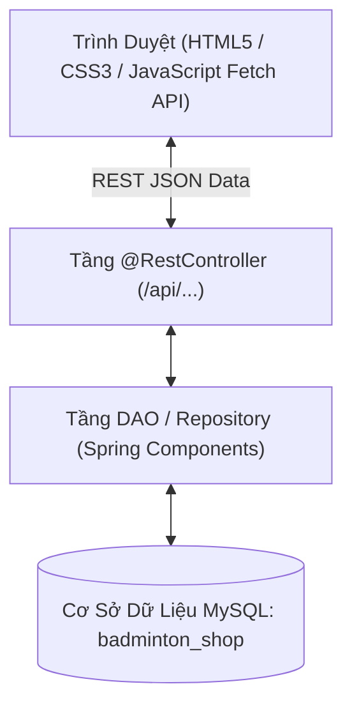

# Hướng Dẫn Xây Dựng Dự Án Web Cầu Lông (Smash Zone) Từ Đầu Bằng Spring Boot & Maven

Tài liệu này hướng dẫn chi tiết từng bước xây dựng một ứng dụng web thương mại điện tử chuyên bán thiết bị cầu lông (**Smash Zone Badminton Shop**) tích hợp **Hệ thống AI Gợi ý sản phẩm thông minh (AI Recommender Engine)** từ đầu bằng **Spring Boot (Maven)**, cơ sở dữ liệu **MySQL**, và giao diện **HTML5 / CSS3 / Vanilla JavaScript Fetch API**.

---

## 📋 Mục Lục
1. [Tổng Quan Kiến Trúc & Công Cụ](#1-tổng-quan-kiến-trúc--công-cụ)
2. [Bước 1: Khởi Tạo Dự Án Maven & Cấu Trúc Thư Mục](#bước-1-khởi-tạo-dự-án-maven--cấu-trúc-thư-mục)
3. [Bước 2: Cấu Hình Cơ Sở Dữ Liệu MySQL](#bước-2-cấu-hình-cơ-sở-dữ-liệu-mysql)
4. [Bước 3: Lập Trình Tầng Model (Bean) & Utilities](#bước-3-lập-trình-tầng-model-bean--utilities)
5. [Bước 4: Lập Trình Tầng Truy Vấn Dữ Liệu (DAO / Repository)](#bước-4-lập-trình-tầng-truy-vấn-dữ-liệu-dao--repository)
6. [Bước 5: Lập Trình Tầng REST API Controllers](#bước-5-lập-trình-tầng-rest-api-controllers)
7. [Bước 6: Xây Dựng Giao Diện HTML5/CSS3/JS Frontend](#bước-6-xây-dựng-giao-diện-html5css3js-frontend)
8. [Bước 7: Khởi Chạy Và Kiểm Thử Trên NetBeans IDE](#bước-7-khởi-chạy-và-kiểm-thử-trên-netbeans-ide)

---

## 1. Tổng Quan Kiến Trúc & Công Cụ

### Kiến Trúc Ứng Dụng


### Công Cụ Cần Thiết
- **Java Development Kit (JDK)**: JDK 17, 21 hoặc 24.
- **IDE**: Apache NetBeans (hoặc IntelliJ IDEA, VS Code).
- **Cơ sở dữ liệu**: MySQL Server 8.x + MySQL Workbench / phpMyAdmin.
- **Build System**: Apache Maven 3.x.

---

## Bước 1: Khởi Tạo Dự Án Maven & Cấu Trúc Thư Mục

### 1.1 Cấu Trúc Thư Mục Chuẩn Maven
Tạo thư mục dự án và tổ chức theo cấu trúc sau:

```text
smashzone/
├── pom.xml
├── nbactions.xml
└── src/
    └── main/
        ├── java/
        │   └── com/
        │       └── smashzone/
        │           ├── SmashZoneApplication.java
        │           ├── controller/
        │           │   ├── AdminApiController.java
        │           │   ├── AuthController.java
        │           │   ├── CartApiController.java
        │           │   ├── HomeController.java
        │           │   ├── OrderApiController.java
        │           │   ├── ProductApiController.java
        │           │   └── ProfileApiController.java
        │           ├── model/
        │           │   ├── bean/
        │           │   │   ├── CartItem.java
        │           │   │   ├── Category.java
        │           │   │   ├── Order.java
        │           │   │   ├── OrderDetail.java
        │           │   │   ├── Product.java
        │           │   │   ├── ProductRecommendation.java
        │           │   │   ├── User.java
        │           │   │   └── UserInteraction.java
        │           │   └── dao/
        │           │       ├── CategoryDAO.java
        │           │       ├── InteractionDAO.java
        │           │       ├── OrderDAO.java
        │           │       ├── ProductDAO.java
        │           │       ├── RecommendationDAO.java
        │           │       └── UserDAO.java
        │           └── util/
        │               ├── DBContext.java
        │               └── SecurityUtil.java
        └── resources/
            ├── application.properties
            └── static/
                ├── index.html
                ├── products.html
                ├── product-detail.html
                ├── cart.html
                ├── checkout.html
                ├── login.html
                ├── register.html
                ├── profile.html
                ├── order-history.html
                ├── admin/
                │   ├── dashboard.html
                │   ├── products.html
                │   ├── orders.html
                │   └── users.html
                └── assets/
                    ├── css/
                    └── js/
                        └── main.js
```

### 1.2 File Cấu Hình Maven (`pom.xml`)

Tạo file `pom.xml` tại thư mục gốc:

```xml
<?xml version="1.0" encoding="UTF-8"?>
<project xmlns="http://maven.apache.org/POM/4.0.0"
         xmlns:xsi="http://www.w3.org/2001/XMLSchema-instance"
         xsi:schemaLocation="http://maven.apache.org/POM/4.0.0 http://maven.apache.org/xsd/maven-4.0.0.xsd">
    <modelVersion>4.0.0</modelVersion>

    <groupId>com.smashzone</groupId>
    <artifactId>smashzone</artifactId>
    <version>1.0.0</version>
    <name>Smash Zone Badminton Shop</name>
    <description>Spring Boot REST API Web Application for Smash Zone Badminton Shop</description>

    <parent>
        <groupId>org.springframework.boot</groupId>
        <artifactId>spring-boot-starter-parent</artifactId>
        <version>2.7.18</version>
        <relativePath/>
    </parent>

    <properties>
        <java.version>17</java.version>
        <start-class>com.smashzone.SmashZoneApplication</start-class>
        <mainClass>com.smashzone.SmashZoneApplication</mainClass>
        <exec.mainClass>com.smashzone.SmashZoneApplication</exec.mainClass>
        <exec.executable>java</exec.executable>
        <project.build.sourceEncoding>UTF-8</project.build.sourceEncoding>
        <project.reporting.outputEncoding>UTF-8</project.reporting.outputEncoding>
    </properties>

    <dependencies>
        <!-- Spring Boot Web -->
        <dependency>
            <groupId>org.springframework.boot</groupId>
            <artifactId>spring-boot-starter-web</artifactId>
        </dependency>

        <!-- Spring Boot JDBC -->
        <dependency>
            <groupId>org.springframework.boot</groupId>
            <artifactId>spring-boot-starter-jdbc</artifactId>
        </dependency>

        <!-- MySQL Connector -->
        <dependency>
            <groupId>mysql</groupId>
            <artifactId>mysql-connector-java</artifactId>
            <version>8.0.33</version>
        </dependency>

        <!-- Spring Boot DevTools for Hot Reload -->
        <dependency>
            <groupId>org.springframework.boot</groupId>
            <artifactId>spring-boot-devtools</artifactId>
            <scope>runtime</scope>
            <optional>true</optional>
        </dependency>
    </dependencies>

    <build>
        <plugins>
            <plugin>
                <groupId>org.springframework.boot</groupId>
                <artifactId>spring-boot-maven-plugin</artifactId>
                <configuration>
                    <mainClass>com.smashzone.SmashZoneApplication</mainClass>
                </configuration>
            </plugin>
            <plugin>
                <groupId>org.codehaus.mojo</groupId>
                <artifactId>exec-maven-plugin</artifactId>
                <version>3.1.0</version>
                <configuration>
                    <executable>java</executable>
                    <mainClass>com.smashzone.SmashZoneApplication</mainClass>
                </configuration>
            </plugin>
        </plugins>
    </build>
</project>
```

---

## Bước 2: Cấu Hình Cơ Sở Dữ Liệu MySQL

### 2.1 File Cấu Hình `application.properties`
Tạo file `src/main/resources/application.properties`:

```properties
# Server Port
server.port=8080

# Spring DataSource (MySQL configuration)
spring.datasource.url=jdbc:mysql://localhost:3306/badminton_shop?useUnicode=true&characterEncoding=utf-8&useSSL=false&allowPublicKeyRetrieval=true&serverTimezone=UTC
spring.datasource.username=root
spring.datasource.password=123456
spring.datasource.driver-class-name=com.mysql.cj.jdbc.Driver

# Connection Pool Settings
spring.datasource.hikari.maximum-pool-size=10
spring.datasource.hikari.minimum-idle=2
spring.datasource.hikari.idle-timeout=300000

# Static Resources Handling
spring.web.resources.static-locations=classpath:/static/
spring.mvc.static-path-pattern=/**
```

### 2.2 Script Khởi Tạo Database SQL (`badminton_shop`)

Chạy đoạn script sau trên MySQL Workbench / phpMyAdmin:

```sql
CREATE DATABASE IF NOT EXISTS badminton_shop CHARACTER SET utf8mb4 COLLATE utf8mb4_unicode_ci;
USE badminton_shop;

-- 1. Bảng Khách hàng / Người dùng
CREATE TABLE IF NOT EXISTS users (
    user_id INT AUTO_INCREMENT PRIMARY KEY,
    username VARCHAR(50) UNIQUE NOT NULL,
    password_hash VARCHAR(255) NOT NULL,
    email VARCHAR(100),
    full_name VARCHAR(100),
    phone_number VARCHAR(20),
    address VARCHAR(255),
    city VARCHAR(50),
    detail_address VARCHAR(255),
    date_of_birth DATE,
    avatar VARCHAR(255),
    role VARCHAR(20) DEFAULT 'CUSTOMER',
    created_at TIMESTAMP DEFAULT CURRENT_TIMESTAMP
);

-- 2. Bảng Danh mục sản phẩm
CREATE TABLE IF NOT EXISTS categories (
    category_id INT AUTO_INCREMENT PRIMARY KEY,
    name VARCHAR(100) NOT NULL
);

-- 3. Bảng Sản phẩm
CREATE TABLE IF NOT EXISTS products (
    product_id INT AUTO_INCREMENT PRIMARY KEY,
    category_id INT,
    name VARCHAR(255) NOT NULL,
    price DECIMAL(12,2) NOT NULL,
    import_price DECIMAL(12,2) DEFAULT 0,
    quantity INT DEFAULT 50,
    image VARCHAR(500),
    product_link VARCHAR(500),
    metadata_for_ai TEXT,
    specific_attributes JSON,
    created_at TIMESTAMP DEFAULT CURRENT_TIMESTAMP,
    FOREIGN KEY (category_id) REFERENCES categories(category_id)
);

-- 4. Bảng Đơn hàng
CREATE TABLE IF NOT EXISTS orders (
    order_id INT AUTO_INCREMENT PRIMARY KEY,
    user_id INT,
    total_amount DECIMAL(12,2) NOT NULL,
    status VARCHAR(50) DEFAULT 'PENDING',
    delivery_address VARCHAR(255),
    created_at TIMESTAMP DEFAULT CURRENT_TIMESTAMP,
    FOREIGN KEY (user_id) REFERENCES users(user_id)
);

-- 5. Bảng Chi tiết đơn hàng
CREATE TABLE IF NOT EXISTS order_details (
    order_detail_id INT AUTO_INCREMENT PRIMARY KEY,
    order_id INT,
    product_id INT,
    quantity INT NOT NULL,
    unit_price DECIMAL(12,2) NOT NULL,
    FOREIGN KEY (order_id) REFERENCES orders(order_id),
    FOREIGN KEY (product_id) REFERENCES products(product_id)
);

-- 6. Bảng Hành vi tương tác người dùng (Cho AI Recommendation)
CREATE TABLE IF NOT EXISTS user_interactions (
    interaction_id INT AUTO_INCREMENT PRIMARY KEY,
    user_id INT,
    product_id INT,
    interaction_type VARCHAR(30) NOT NULL, -- VIEW, ADD_TO_CART, PURCHASE
    interaction_value INT NOT NULL,       -- VIEW=1, ADD_TO_CART=3, PURCHASE=5
    created_at TIMESTAMP DEFAULT CURRENT_TIMESTAMP
);

-- 7. Bảng Gợi ý sản phẩm tính toán trước (TF-IDF Content-Based)
CREATE TABLE IF NOT EXISTS product_recommendations (
    recommendation_id INT AUTO_INCREMENT PRIMARY KEY,
    product_id INT,
    recommended_product_id INT,
    similarity_score DOUBLE,
    algorithm_used VARCHAR(50),
    UNIQUE KEY unique_rec (product_id, recommended_product_id, algorithm_used)
);
```

---

## Bước 3: Lập Trình Tầng Model (Bean) & Utilities

### 3.1 Class Quản Lý Kết Nối `DBContext.java`
Tạo tại `com.smashzone.util.DBContext`:

```java
package com.smashzone.util;

import org.springframework.beans.factory.annotation.Autowired;
import org.springframework.stereotype.Component;

import javax.annotation.PostConstruct;
import javax.sql.DataSource;
import java.sql.Connection;
import java.sql.DriverManager;
import java.sql.SQLException;

@Component
public class DBContext {
    private static final String DRIVER = "com.mysql.cj.jdbc.Driver";
    private static final String URL = "jdbc:mysql://localhost:3306/badminton_shop?useUnicode=true&characterEncoding=utf-8&useSSL=false&allowPublicKeyRetrieval=true&serverTimezone=UTC";
    private static final String USER = "root";
    private static final String PASSWORD = "123456";

    private static DataSource springDataSource;

    @Autowired(required = false)
    private DataSource dataSource;

    @PostConstruct
    public void init() {
        if (this.dataSource != null) {
            springDataSource = this.dataSource;
        }
    }

    static {
        try { Class.forName(DRIVER); } catch (ClassNotFoundException e) { e.printStackTrace(); }
    }

    public static Connection getConnection() throws SQLException {
        if (springDataSource != null) {
            try { return springDataSource.getConnection(); } catch (SQLException e) {}
        }
        return DriverManager.getConnection(URL, USER, PASSWORD);
    }
}
```

### 3.2 Class Mã Hóa Mật Khẩu `SecurityUtil.java`
Tạo tại `com.smashzone.util.SecurityUtil`:

```java
package com.smashzone.util;

import java.security.MessageDigest;
import java.security.NoSuchAlgorithmException;

public class SecurityUtil {
    public static String hashPasswordMD5(String password) {
        if (password == null) return null;
        try {
            MessageDigest md = MessageDigest.getInstance("MD5");
            byte[] messageDigest = md.digest(password.getBytes());
            StringBuilder sb = new StringBuilder();
            for (byte b : messageDigest) {
                sb.append(String.format("%02x", b));
            }
            return sb.toString();
        } catch (NoSuchAlgorithmException e) {
            return null;
        }
    }

    public static boolean verifyPassword(String plainPassword, String hashedPassword) {
        if (plainPassword == null || hashedPassword == null) return false;
        String md5Hash = hashPasswordMD5(plainPassword);
        return (md5Hash != null && md5Hash.equalsIgnoreCase(hashedPassword)) || plainPassword.equals(hashedPassword);
    }
}
```

---

## Bước 4: Lập Trình Tầng Truy Vấn Dữ Liệu (DAO / Repository)

Khai báo các DAO dưới dạng `@Repository` trong Spring để Spring Container tự động quản lý Bean.

### 4.1 Class `UserDAO.java`
- Xử lý các nghiệp vụ Đăng nhập (`login`), Đăng ký (`registerUser`), Cập nhật thông tin cá nhân (`updateUser`), Đổi mật khẩu (`changePassword`), và Quản lý trạng thái khóa tài khoản (`updateUserStatus`).

### 4.2 Class `ProductDAO.java`
- Xử lý lấy danh sách sản phẩm, Tìm kiếm theo từ khóa (`searchProducts`), Lọc theo danh mục (`getProductsByCategory`), Lấy danh sách sản phẩm bán chạy nhất (`getTrendingProducts`), Thêm/Sửa/Xóa sản phẩm cho Admin.

### 4.3 Class `OrderDAO.java`
- Xử lý đặt hàng theo cơ chế **Transaction Atomic Checkout**:
  ```java
  public boolean checkout(Order order, List<CartItem> cart) {
      // 1. Bắt đầu Transaction (conn.setAutoCommit(false))
      // 2. Thêm mới đơn hàng vào bảng orders -> Lấy order_id vừa tạo
      // 3. Lặp qua danh sách giỏ hàng: Thêm vào order_details và Trừ số lượng kho (quantity) trong sản phẩm
      // 4. Hoàn thành transaction (conn.commit())
  }
  ```

### 4.4 Class `InteractionDAO.java` & `RecommendationDAO.java`
- Ghi nhận mọi tương tác của người dùng (`recordInteraction`) với các trọng số:
  - `VIEW`: Trọng số 1
  - `ADD_TO_CART`: Trọng số 3
  - `PURCHASE`: Trọng số 5
- Truy vấn các thuật toán gợi ý AI:
  - `getSimilarProductsByContent`: Gợi ý sản phẩm tương tự bằng thuật toán **TF-IDF Content-Based**.
  - `getCollaborativeFilteringRecommendations`: Gợi ý sản phẩm dựa trên hành vi mua sắm của các lông thủ khác có cùng sở thích.

---

## Bước 5: Lập Trình Tầng REST API Controllers

### 5.1 Main Entry Class `SmashZoneApplication.java`
Tạo tại `com.smashzone.SmashZoneApplication`:

```java
package com.smashzone;

import org.springframework.boot.SpringApplication;
import org.springframework.boot.autoconfigure.SpringBootApplication;

@SpringBootApplication
public class SmashZoneApplication {
    public static void main(String[] args) {
        SpringApplication.run(SmashZoneApplication.class, args);
    }
}
```

### 5.2 Danh Sách Các REST API Endpoint

| Controller | HTTP Method | Endpoint | Mô Tả |
| :--- | :--- | :--- | :--- |
| `AuthController` | `POST` | `/api/auth/login` | Đăng nhập tài khoản |
| `AuthController` | `POST` | `/api/auth/register` | Đăng ký tài khoản mới |
| `AuthController` | `GET` | `/api/auth/me` | Lấy thông tin User đang đăng nhập từ Session |
| `AuthController` | `POST` | `/api/auth/logout` | Đăng xuất |
| `ProductApiController` | `GET` | `/api/products` | Lấy danh sách sản phẩm (Hỗ trợ search & category) |
| `ProductApiController` | `GET` | `/api/products/{id}` | Lấy chi tiết 1 sản phẩm & gợi ý tương tự |
| `HomeController` | `GET` | `/api/home/data` | Lấy 3 khối AI Recommender Feeds cho trang chủ |
| `CartApiController` | `GET` | `/api/cart` | Lấy danh sách giỏ hàng trong Session |
| `CartApiController` | `POST` | `/api/cart/add` | Thêm sản phẩm vào giỏ |
| `CartApiController` | `POST` | `/api/cart/update` | Cập nhật số lượng sản phẩm |
| `CartApiController` | `POST` | `/api/cart/remove` | Xóa sản phẩm khỏi giỏ |
| `OrderApiController` | `POST` | `/api/orders/checkout` | Tiến hành thanh toán và tạo đơn hàng |
| `OrderApiController` | `GET` | `/api/orders/my-orders` | Lấy lịch sử đơn hàng của người dùng |
| `AdminApiController` | `GET` | `/api/admin/dashboard` | Lấy thống kê tổng doanh thu, đơn hàng, người dùng |
| `AdminApiController` | `POST` | `/api/admin/products` | Admin thêm mới sản phẩm |
| `AdminApiController` | `PUT` | `/api/admin/orders/{id}/status` | Admin cập nhật trạng thái đơn hàng |

---

## Bước 6: Xây Dựng Giao Diện HTML5/CSS3/JS Frontend

Tất cả các tài nguyên giao diện được đặt tại thư mục `src/main/resources/static/`. Spring Boot sẽ tự động map thư mục này ra root URL `/`.

### 6.1 JavaScript Wrapper Chung (`assets/js/main.js`)
File này quản lý tự động trạng thái đăng nhập trên Header, cập nhật số lượng giỏ hàng badge, và định dạng tiền tệ VNĐ:

```javascript
function formatCurrency(amount) {
    if (!amount && amount !== 0) return '0 đ';
    return new Intl.NumberFormat('vi-VN', { style: 'currency', currency: 'VND' }).format(amount);
}

document.addEventListener('DOMContentLoaded', function() {
    checkCurrentUser();
    updateCartCount();
});

function checkCurrentUser() {
    fetch('/api/auth/me')
        .then(res => res.json())
        .then(data => {
            const userNav = document.getElementById('user-nav');
            if (!userNav) return;

            if (data.authenticated && data.user) {
                const user = data.user;
                const isAdmin = user.role === 'ADMIN';
                userNav.innerHTML = `
                    <div class="user-dropdown">
                        <span>👋 Xin chào, <strong>${user.fullName || user.username}</strong></span>
                        <div class="dropdown-content">
                            <a href="/profile.html">👤 Trang cá nhân</a>
                            <a href="/order-history.html">📦 Lịch sử đơn hàng</a>
                            ${isAdmin ? '<a href="/admin/dashboard.html">⚙️ Quản trị Admin</a>' : ''}
                            <a href="#" onclick="logout(); return false;" style="color:#ef4444;">🚪 Đăng xuất</a>
                        </div>
                    </div>
                `;
            } else {
                userNav.innerHTML = `
                    <a href="/login.html" class="btn btn-secondary">Đăng Nhập</a>
                    <a href="/register.html" class="btn btn-primary">Đăng Ký</a>
                `;
            }
        });
}

function addToCart(productId, quantity = 1) {
    fetch('/api/cart/add', {
        method: 'POST',
        headers: { 'Content-Type': 'application/json' },
        body: JSON.stringify({ productId: productId, quantity: quantity })
    })
    .then(res => res.json())
    .then(data => {
        if (data.success) {
            alert("✅ " + data.message);
            updateCartCount();
        } else {
            alert("❌ " + data.message);
        }
    });
}
```

---

## Bước 7: Khởi Chạy Và Kiểm Thử Trên NetBeans IDE

### 7.1 Cấu Hình NetBeans (`nbactions.xml`)
Tạo file `nbactions.xml` tại thư mục gốc dự án:

```xml
<?xml version="1.0" encoding="UTF-8"?>
<actions>
    <action>
        <actionName>run</actionName>
        <packagings>
            <packaging>jar</packaging>
        </packagings>
        <goals>
            <goal>spring-boot:run</goal>
        </goals>
        <properties>
            <spring-boot.run.main-class>com.smashzone.SmashZoneApplication</spring-boot.run.main-class>
        </properties>
    </action>
    <action>
        <actionName>debug</actionName>
        <packagings>
            <packaging>jar</packaging>
        </packagings>
        <goals>
            <goal>spring-boot:run</goal>
        </goals>
        <properties>
            <spring-boot.run.main-class>com.smashzone.SmashZoneApplication</spring-boot.run.main-class>
            <spring-boot.run.jvmArguments>-agentlib:jdwp=transport=dt_socket,server=n,address=${jpda.address}</spring-boot.run.jvmArguments>
            <jpda.listen>true</jpda.listen>
        </properties>
    </action>
</actions>
```

### 7.2 Thao Tác Chạy Trên NetBeans IDE
1. Mở NetBeans IDE -> Chọn **File -> Open Project...**
2. Chọn thư mục dự án `smashzone`.
3. Nhấn phím **F6** (hoặc nút **Run Project**).
4. Mở trình duyệt web bất kỳ và truy cập địa chỉ:
   - Trang chủ người dùng: **`http://localhost:8080`**
   - Trang quản trị Admin: **`http://localhost:8080/admin/dashboard.html`**
